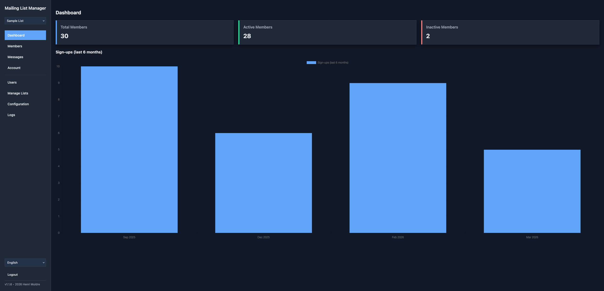

# Mailing List Manager

Self-hosted mailing list software with two parts:

- `list/`: the mailer that fetches messages from IMAP and redistributes them via SMTP
- `list-admin/`: the web admin UI for managing lists, members, sent messages, users, logs and global settings



This app was initially designed to be run in a limited-access shared webhost server, hence the usage of cron jobs, pm2 etc.
If you have a webserver that is not shared and you have root/full access, then there are of course better ways to run this app.

The current deployment model uses:

- Python 3
- PostgreSQL
- PM2 for keeping the admin UI process alive (either managed from your host's control panel or by yourself)
- cron for running the mailer and an optional PM2 watchdog for hosts without a PM2 management panel

## What This Repository Contains

- The mailer runtime in [`list/mlist.py`](list/mlist.py)
- The admin UI in [`list-admin/app.py`](list-admin/app.py)
- The one-shot credential migration in [`scripts/migrate_mail_credentials.py`](scripts/migrate_mail_credentials.py)
- A portable mailer launcher in [`list/run_mlist.sh`](list/run_mlist.sh)
- A PM2 process definition for the admin UI in [`list-admin/ecosystem.config.js`](list-admin/ecosystem.config.js)
- An optional PM2 watchdog for the admin UI in [`list-admin/ensure-list-admin.sh`](list-admin/ensure-list-admin.sh), for hosts without a PM2 management panel
- A clean bootstrap schema in [`list-admin/sql/schema.sql`](list-admin/sql/schema.sql)
- Example environment files [`list/.env.example`](list/.env.example) and [`list-admin/.env.example`](list-admin/.env.example)

## Requirements

- Python 3.11+ recommended
- PostgreSQL
- Node.js + PM2
- A reverse proxy such as Nginx or Apache for the admin UI

## Project Setup

### 1. Clone the repo

```bash
git clone https://github.com/henrimuldre/mailing-list-manager
cd mailing-list-manager
```

### 2. Create Python virtual environments

You can use one shared virtual environment if you prefer, but separate venvs keep the shell scripts simple.

```bash
python3 -m venv list/.venv
python3 -m venv list-admin/.venv
list/.venv/bin/pip install -r list/requirements.txt
list-admin/.venv/bin/pip install -r list-admin/requirements.txt
```

If installing dependencies fails on `cryptography` on platforms without a compatible
prebuilt wheel, such as some FreeBSD or shared-hosting environments, `pip` may fall back
to building from source. In that case you may need Rust installed before rerunning the
`pip install` commands.

<details>
<summary>Install Rust only if <code>cryptography</code> fails to build</summary>

If `pip install` fails while building `cryptography`, install Rust with the official
`rustup` installer, reload your shell environment and then rerun the dependency install:

```bash
curl --proto '=https' --tlsv1.2 -sSf https://sh.rustup.rs | sh
. "$HOME/.cargo/env"
rustc --version
cargo --version
```

Then retry:

```bash
list/.venv/bin/pip install -r list/requirements.txt
list-admin/.venv/bin/pip install -r list-admin/requirements.txt
```

</details>

### 3. Configure environment files

```bash
cp list/.env.example list/.env
cp list-admin/.env.example list-admin/.env
```

Then edit both `.env` files with your real values.

Important variables:

- `DB_HOST`, `DB_PORT`, `DB_NAME`, `DB_USER`, `DB_PASS`
- `FLASK_SECRET` for the admin UI
- `MAIL_CREDENTIALS_KEY` shared by `list/` and `list-admin/`
- `LIST_ADMIN_HOST`, `LIST_ADMIN_PORT`

Generate `MAIL_CREDENTIALS_KEY` with:

```bash
python3 -c "from cryptography.fernet import Fernet; print(Fernet.generate_key().decode())"
```

Once `MAIL_CREDENTIALS_KEY` is set, newly saved IMAP/SMTP passwords are stored in the
database as encrypted `enc:v1:...` values instead of raw text. Existing plaintext values
remain readable for backward compatibility and will be encrypted the next time that list is
saved through the admin UI.

Fresh install vs upgrade:

- Fresh install with a new database: no migration is needed. Set the same `MAIL_CREDENTIALS_KEY` in both `list/.env` and `list-admin/.env` before creating any lists.
- Upgrade of an existing deployment with old plaintext credentials already in `mailing_lists`: run the migration once to convert those legacy rows.

To migrate all existing plaintext credentials in one go:

```bash
list-admin/.venv/bin/python scripts/migrate_mail_credentials.py --dry-run
list-admin/.venv/bin/python scripts/migrate_mail_credentials.py
```

The script auto-loads `list-admin/.env` and `list/.env`, skips rows already stored as
`enc:v1:...` and only updates rows that still contain legacy plaintext values. Both services
log a warning when they read a password that is still stored in plaintext.

#### Rotating `MAIL_CREDENTIALS_KEY`

1. Generate a new key (command above).
2. In **both** `.env` files, put the new key in `MAIL_CREDENTIALS_KEY` and the old one in
   `MAIL_CREDENTIALS_OLD_KEYS`, then restart the admin UI.
3. Re-encrypt everything with the new key:

   ```bash
   list-admin/.venv/bin/python scripts/migrate_mail_credentials.py --rotate --dry-run
   list-admin/.venv/bin/python scripts/migrate_mail_credentials.py --rotate
   ```

4. Remove `MAIL_CREDENTIALS_OLD_KEYS` from both files and restart the admin UI again.

### 4. Create the database schema

Import the canonical schema:

```bash
psql -U <db-user> -d <db-name> -f list-admin/sql/schema.sql
```

Besides the schema, the database only needs **one admin user**, so you can log in.
Everything else is set up later in the admin UI.

#### Create the first admin user

1. Make a password hash. The command asks for the password - it isn't shown or saved.
   Use at least 12 characters (the minimum the admin UI enforces for new passwords).

   ```bash
   list-admin/.venv/bin/python -c "import getpass; from werkzeug.security import generate_password_hash; print(generate_password_hash(getpass.getpass('Admin password: ')))"
   ```

2. Open `psql -U <db-user> -d <db-name>` and insert the user, pasting the whole hash
   (it starts with `scrypt:`) between the single quotes:

   ```sql
   INSERT INTO users (username, password_hash, role) VALUES ('admin', 'scrypt:...', 'admin');
   ```

Further users can then be added in the admin UI under **Users**.

#### Mailing lists and settings

- **Mailing lists** are created in the admin UI under **Manage Lists**.
- **Settings** all have built-in defaults, so the `app_config` table can start empty. Saving
  the admin UI's **Configuration** page stores your values to the database. For settings that can also be configured with the `.env` file, the order is: Configuration page → `.env` → built-in default.

### 5. Start the admin UI

Direct run:

```bash
cd list-admin
.venv/bin/python app.py --host 127.0.0.1 --port 9010 --no-debug --no-reload --no-debugger
```

PM2-managed run. Pick the option that matches your host:

**Option A: your host manages PM2 apps from its control panel.** Add an app named `list-admin` in the panel
with `list-admin/app.py` as the script, `list-admin/.venv/bin/python` as the interpreter and
`--no-debug --no-reload --no-debugger` as arguments (or import [`list-admin/ecosystem.config.js`](list-admin/ecosystem.config.js)
if the panel supports it). The host then keeps the process alive and no watchdog or cron entry is needed for the admin UI.

**Option B: you manage PM2 yourself.** Start it with the included process definition:

```bash
cd list-admin
pm2 start ecosystem.config.js
```

PM2 restarts the app if it crashes, but not if the PM2 daemon itself is stopped (for example after a server reboot
on a shared host where you cannot use `pm2 startup`). For that case, use the watchdog, which checks the app over HTTP
and starts or restarts it through PM2 when needed:

```bash
cd list-admin
./ensure-list-admin.sh
```

Run it from cron (see [Cron Setup](#cron-setup)). The watchdog script expects PM2 to be available in `PATH`
and writes to `list-admin/logs/ensure-list-admin.log`, which then also appears on the admin UI's Logs page.

Either way, if `list-admin/.venv` exists, `app.py` re-launches itself with that venv's Python when started with
a different interpreter, so a panel that defaults to the system Python still works.

Useful watchdog tuning env vars:

- `STARTUP_WAIT_SECONDS` to allow extra warm-up time before a fresh `pm2 start` or `pm2 restart` is treated as failed
- `HEALTH_TIMEOUT`, `HEALTH_RETRIES`, `HEALTH_CHECK_INTERVAL` to tune the HTTP health probe behavior

### 6. Run the mailer

Manual run:

```bash
cd list
./run_mlist.sh
```

The script will use:

- `LIST_PYTHON` if set
- otherwise `list/.venv/bin/python` if present
- otherwise plain `python3`

## Cron Setup

Example cron entries:

```cron
*/2 * * * * /path/to/repo/list/run_mlist.sh
# Only if you manage PM2 yourself (Option B above):
0 */2 * * * /path/to/repo/list-admin/ensure-list-admin.sh
```

`*/2` for `run_mlist.sh` is a reasonable production default if you want mail delivery to stay responsive.
If you see occasional IMAP read timeouts but overall delivery is working, prefer increasing `SOCKET_TIMEOUT_SECONDS`
in `list/.env` to `90` or `120` before slowing the cron interval down.

Adjust the intervals to your needs.

## Web Access

The admin UI should not be exposed directly without TLS. Use one of these patterns,
depending on what your host supports.

### Option A: Reverse proxy on the same server

Use this when your web server can proxy requests to a local Flask process.

Example local Flask target (in the example, I used port 9010 configured in the .env file):

- `127.0.0.1:9010`

Expose that target through your web server and TLS setup, for example:

- `https://listadmin.example.com`

If your Apache host supports per-directory proxy rules and has the required proxy/header
modules enabled, you can create a small web directory for the admin UI proxy, point a
subdomain such as `listadmin.example.com` to that directory and place an `.htaccess` file
like this there:

```apache
# BEGIN List Admin Proxy
RewriteEngine On

# Proxy everything to the local Flask app
RewriteRule ^(.*)$ http://127.0.0.1:9010/$1 [P,L]

# Rewrite backend redirects to your public HTTPS URL
<IfModule mod_headers.c>
    Header edit Location ^http://127\.0\.0\.1:9010/ https://listadmin.example.com/
</IfModule>

# Preserve original request context for the Flask app
<IfModule mod_proxy.c>
    RequestHeader set X-Forwarded-Proto "https"
    RequestHeader set X-Forwarded-For %{REMOTE_ADDR}s
</IfModule>
# END List Admin Proxy
```

### Option B: Shared-host or managed-host port forwarding

Use this when your host provides an internal app IP/port and a control panel for
public port forwarding instead of a traditional reverse proxy.

- bind the admin UI to the internal IP and port assigned by your host
- configure the host's TCP/PM2/port-forwarding panel to forward public traffic to that internal target
- keep TLS and external access controls configured at the host/web-server layer

For either option, set `LIST_ADMIN_HOST` and `LIST_ADMIN_PORT` in `list-admin/.env`
to the address and port the Flask process should bind to.

## Security

- **Protect the `.env` files.** They hold the database password, `FLASK_SECRET` and
  `MAIL_CREDENTIALS_KEY`, which together decrypt every stored mailbox password:
  `chmod 600 list/.env list-admin/.env`. Don't pass these values to PM2 as environment
  variables (PM2 saves them in plain text in `~/.pm2/dump.pm2`). The app reads `.env` itself.
- **Login protection:** failed logins are rate-limited per IP and per username and logged with
  the client IP. New passwords need at least `MIN_PASSWORD_LENGTH` characters (default 12).
  Changing your own password requires the current one and ends the user's other sessions.
- **Every form carries a CSRF token** and the app sends a Content-Security-Policy (no inline
  scripts), `X-Frame-Options: DENY`, HSTS and related headers.
- **Sender authentication:** on closed lists the `From` address alone can be forged. With
  `SENDER_AUTH_MODE` the mailer also checks the SPF/DKIM/DMARC results your mail server writes
  into `Authentication-Results`. It defaults to `log`: watch `mlist.log` for
  `sender auth ... pass` on real member mail, set `TRUSTED_AUTHSERV_IDS` to your mail server's
  name, then switch to `enforce`. Both can be set on the admin UI's **Configuration** page
  (takes priority) or in `list/.env`. The default is `log`, if it isn't set anywhere.
- IMAP and SMTP connections verify the server's TLS certificate.

## Upgrading from v1.2.0

1. Update the code and reinstall dependencies in both venvs (`pip install -r requirements.txt`).
2. Optional: add the new settings from the `.env.example` files (all have safe defaults).
3. Make new lists closed by default in existing databases:

   ```sql
   ALTER TABLE mailing_lists ALTER COLUMN open_posting SET DEFAULT false;
   ```

4. Restart the admin UI. Everyone has to log in once more after the upgrade.

## To-do in the future

- First-run setup page in the admin UI for creating the first admin user (protected by a one-time setup code), instead of the manual SQL steps
- Replace Flask's built-in server with Gunicorn or another WSGI server for production
- Add automated tests

## Notes

- The admin UI and mailer both rely on PostgreSQL as the source database.
- The mailer reads per-list IMAP/SMTP settings from the database.